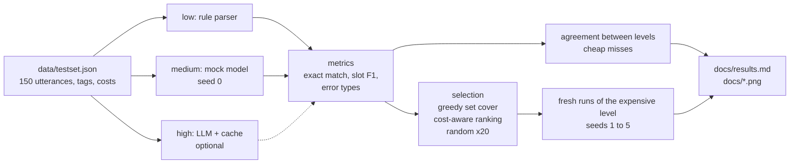

# multi-fidelity-llm-test-optimizer

[](https://github.com/hamza2829/multi-fidelity-llm-test-optimizer/actions/workflows/ci.yml)

A small Python project that evaluates a simulated in-car voice assistant at three
fidelity levels (cheap to expensive) and selects a small subset of tests that still
finds the failure categories of the full test set.

The assistant, the test set and the costs are simulated. All numbers below were
measured on this project's own data with `python -m mfopt.run`. Nothing here says
anything about real cars or real in-car assistants.

## What it does

1. **System under test.** A text to intent parser for commands such as "set temperature
   to 21", "navigate to the nearest charger" or "what is my tire pressure". The output
   is JSON: `{"action": ..., "slots": {...}}`. One interface (`Assistant.predict`), three levels:
   - **low**: rule-based regex parser. Instant, free, brittle.
   - **medium**: mock "small local model". A keyword classifier with fuzzy typo
     correction, plus controlled random errors (confused action, dropped or wrong slot,
     extra slot, broken JSON). Error rate and seed are parameters. No API, no weights.
   - **high**: optional real LLM call (Anthropic Messages API) with a JSON cache in
     `data/llm_cache.json`. Disabled by default. Without a key, the project runs fully
     with low and medium, and medium becomes the expensive level.
2. **Test set.** 150 utterances in `data/testset.json` (120 clean + 30 copies with typos),
   English (89) and German (61), 7 categories, 3 difficulty levels, and a cost per level
   (simulated seconds, plus estimated tokens for the LLM level).
3. **Evaluation.** Exact match, intent accuracy, slot precision/recall/F1, error types
   (`invalid_output`, `wrong_action`, `missing_slot`, `wrong_slot_value`, `extra_slot`),
   accuracy per tag, and agreement between levels (pass/fail agreement, Cohen kappa,
   2x2 table, tests that only fail at the expensive level).
4. **Test selection.** Greedy set cover and a cost-aware ranking, each compared with
   random subsets of the same size over 20 seeds.
5. **Report.** `docs/results.md`, `docs/results.json` and three charts.

## Pipeline



## Setup

Python 3.10 or newer. No Docker needed.

```bash
git clone https://github.com/hamza2829/multi-fidelity-llm-test-optimizer.git
cd multi-fidelity-llm-test-optimizer
python -m venv .venv
source .venv/bin/activate        # Windows: .venv\Scripts\activate
pip install -r requirements.txt

python -m pytest -v              # 29 tests
python -m mfopt.run              # writes docs/results.md, results.json, charts
```

Optional, to add the high level (costs API credits, about 69k tokens for one pass):

```bash
export ANTHROPIC_API_KEY=...
export MFOPT_ENABLE_LLM=1
python -m mfopt.run              # fills data/llm_cache.json, high becomes the expensive level
```

After that, the cache makes the high level repeatable and usable without a key.
The test set can be regenerated with `python scripts/generate_testset.py` (fixed seed,
same output).

## How the selection works

The setting: every test has been run once at the cheap level (low) and once at the
expensive level (the calibration run). In later runs the cheap level still runs on all
tests because it is free, and the expensive level runs only on a subset.

- **Failure category** = a pair (tag value, error type), for example
  `language=de / missing_slot`. Tags are category, difficulty, language and noise. A failing
  test covers one pair per tag and error type it shows. The calibration run has 45 of them.
- **(a) Coverage.** *Greedy set cover* repeatedly takes the test that covers the most
  uncovered categories. *Cost-aware ranking* scores each test by
  `sum(1 / frequency of each category it covers) / cost` and takes tests in that order
  until all categories are covered, so rare categories and cheap tests come first.
- **(b) Prediction.** Both methods add a random sample of 10 cheap-pass and 10 cheap-fail
  tests. On that sample we estimate P(expensive pass | cheap pass) and
  P(expensive pass | cheap fail). Expensive accuracy on all 150 tests is then estimated as:
  known results for the tests in the subset, plus those probabilities for the rest.
- **Evaluation on fresh runs.** The subset is chosen on the calibration run (seed 0) and
  then checked against 5 new runs of the expensive level (seeds 1 to 5). This shows how much
  of the coverage carries over when the random errors of the model change.
- **Baseline.** Random subsets of the same size, 20 seeds. The prediction sample of each
  method is also redrawn over 20 seeds, so all rows are mean +- std over 20 seeds.

## Results

No API key was used for these numbers, so the expensive level is **medium** and the cheap
level is **low**. Cost is the simulated `medium_s` time per test. The full report, including
the per-test list, is in [docs/results.md](docs/results.md).

### Accuracy by fidelity level

| Level | Exact match | Intent accuracy | Slot F1 | Failed tests | Failure categories | Cost for 150 tests (s) |
|---|---|---|---|---|---|---|
| low | 46.7% | 49.3% | 0.581 | 80 | 30 | 0.1 |
| medium | 81.3% | 89.3% | 0.905 | 28 | 45 | 44.0 |


| Slice | Tests | low exact match | medium exact match |
|---|---|---|---|
| difficulty=easy | 64 | 82.8% | 76.6% |
| difficulty=medium | 52 | 25.0% | 90.4% |
| difficulty=hard | 34 | 11.8% | 76.5% |
| language=de | 61 | 49.2% | 83.6% |
| language=en | 89 | 44.9% | 79.8% |
| noise=clean | 120 | 55.0% | 82.5% |
| noise=typo | 30 | 13.3% | 76.7% |

The rule parser is good on easy phrasings (82.8%) and bad on paraphrases, indirect
requests and typos. The mock model is lower on easy than on medium tests. Part of that is a
real bug in its typo correction: the German word "stelle" is "corrected" to "bestelle"
(order), which pushes "stelle das Gebläse auf Stufe 5" to `unsupported`. The rule parser
gets these right.

### Which categories fail at each level

| Category | Tests | low failures | medium failures |
|---|---|---|---|
| climate | 42 | 28 (wrong_action 28) | 11 (wrong_action 4, wrong_slot_value 3, missing_slot 2, invalid_output 1, extra_slot 1) |
| media | 34 | 19 (wrong_action 18, missing_slot 1) | 6 (wrong_action 3, invalid_output 1, wrong_slot_value 1, missing_slot 1) |
| navigation | 18 | 9 (wrong_action 9) | 4 (wrong_action 2, invalid_output 2) |
| out_of_scope | 11 | 0 | 1 (wrong_action 1) |
| phone | 16 | 10 (wrong_action 9, missing_slot 1) | 3 (wrong_slot_value 2, missing_slot 1) |
| vehicle_info | 16 | 7 (wrong_action 6, missing_slot 1) | 3 (wrong_action 1, invalid_output 1, missing_slot 1) |
| windows | 13 | 7 (wrong_action 6, wrong_slot_value 1) | 0 |


### Where the cheap level misses failures

| Pair | Pass/fail agreement | Cohen kappa | Both pass | Low pass, medium fail | Low fail, medium pass | Both fail |
|---|---|---|---|---|---|---|
| low vs medium | 46.7% | -0.02 | 56 | 14 | 66 | 14 |

- 14 of 150 tests pass at low but fail at medium. Examples: "set temperature to 17" returns
  temperature 16, "what is my oil level" returns cut-off JSON, "book a flight and play it safe"
  becomes `navigate`, and the "stelle das Gebläse" bug above.
- 21 of the 45 failure categories at medium never show up at low, including every
  `invalid_output` and `extra_slot` category. The rule parser cannot produce broken JSON, so
  a cheap run cannot find this kind of failure at all.
- Kappa is about 0: pass/fail at low says almost nothing about pass/fail at medium on this
  data. Using low accuracy as an estimate of medium accuracy would be off by 34.7 percentage
  points.

### Test selection: coverage vs cost

| Method | Tests | Cost saved | Coverage (calibration run) | Coverage (fresh runs) | Accuracy estimate error (pp) |
|---|---|---|---|---|---|
| greedy set cover (15 coverage + 20 sample) | 35 | 76.3% +- 0.3% | 100.0% | 64.5% +- 3.2% | 5.7 +- 1.8 |
| cost-aware ranking (15 coverage + 20 sample) | 35 | 76.2% +- 0.5% | 100.0% | 64.1% +- 3.7% | 6.4 +- 2.6 |
| random, same size (20 seeds) | 35 | 76.4% +- 0.6% | 48.8% +- 12.5% | 47.7% +- 6.9% | 4.8 +- 1.7 |


What these numbers say:

- With about 76% of the expensive cost saved, both methods keep 100% of the failure
  categories of the calibration run. Random subsets of the same size keep 48.8%.
- On fresh runs, coverage drops to about 64%. Many medium failures are random noise, so a
  test that failed in the calibration run often passes in the next run, and new failures
  appear elsewhere. The methods are still about 17 points above random (47.7%).
- The two methods end up almost the same here: both pick 15 coverage tests (13 of them the same) and the curves are nearly
  the same curve. Greedy is better at very small budgets (see the chart below 10% cost).
  With 45 categories and 28 failing tests the cover problem is too small to separate them.
- For predicting the expensive accuracy, the methods are not better than random
  (5.7 and 6.4 pp error vs 4.8 pp). Their prediction sample has 20 tests, while a random
  subset of 35 tests is a 35-test sample. All three are far better than using the cheap
  accuracy alone (34.7 pp).

## Project layout

```
mfopt/
  intents.py            intent schema, slot catalogs, error types
  assistant/            base interface, rule_based (low), mock_model (medium), llm (high)
  metrics.py            parsing, scoring, slot F1, kappa, agreement
  selection.py          greedy set cover, cost-aware ranking, random, estimator, curves
  run.py                full pipeline (python -m mfopt.run)
  report.py, charts.py  docs/results.md and docs/*.png
scripts/generate_testset.py
data/testset.json
tests/                  unit tests (metrics, selection, assistants) and one integration test
.github/workflows/ci.yml
```

CI runs on GitHub Actions with Python 3.10 and 3.12: pytest, a full pipeline run without
any API key, and a check that the committed `docs/results.json` matches a fresh run.

## Limits and what I would change

- **Simulated assistant.** The medium level is not a real model. Its errors are injected
  with a chosen rate, so "medium finds failures that low misses" is partly true by design
  (low can never return broken JSON). The numbers show that the pipeline works, not how a
  real small model behaves. Next step: replace the mock with a real small local model
  (for example a quantized model through llama.cpp) and run the high level for real.
- **Synthetic test set.** 150 utterances from 61 hand-written templates, typos made by
  random character edits. Real speech recognition errors look different (homophones,
  split words, missing umlauts). Many tests are near duplicates of the same template.
- **Small data.** 150 tests, 28 failures at the expensive level, 45 failure categories. One
  failing test changes a coverage number by a few points. The +- values are over seeds
  only and do not cover the variation from a different test set.
- **High level not measured.** No API key was used, so there are no LLM results in this
  report. The cache code path is unit tested, the API call is not.
- **Costs are made up.** Seconds and tokens come from a simple formula in the generator,
  not from timing.
- **Coverage overfits.** The selection uses one calibration run. Using several runs, or a
  failure probability per test instead of a single pass/fail, would likely carry over
  better to new runs.
- **Prediction is simple.** The estimator only conditions on the cheap pass/fail result.
  Conditioning on tags (category, noise) or using the cheap output itself as a feature
  could reduce the error, but needs more data than 150 tests.
