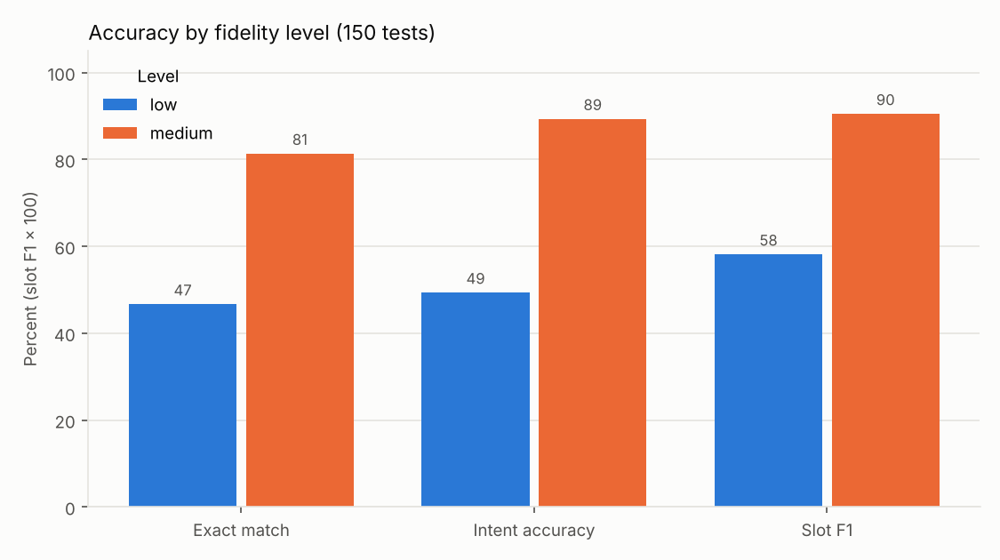
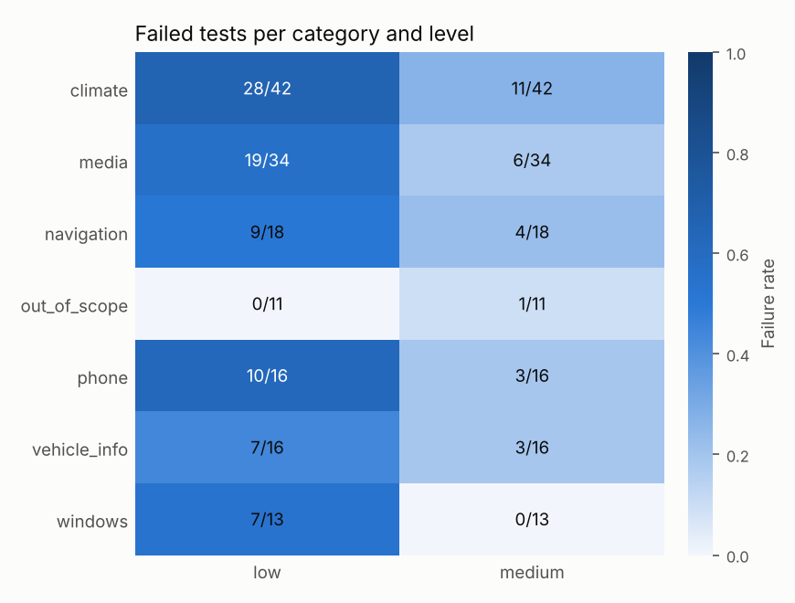
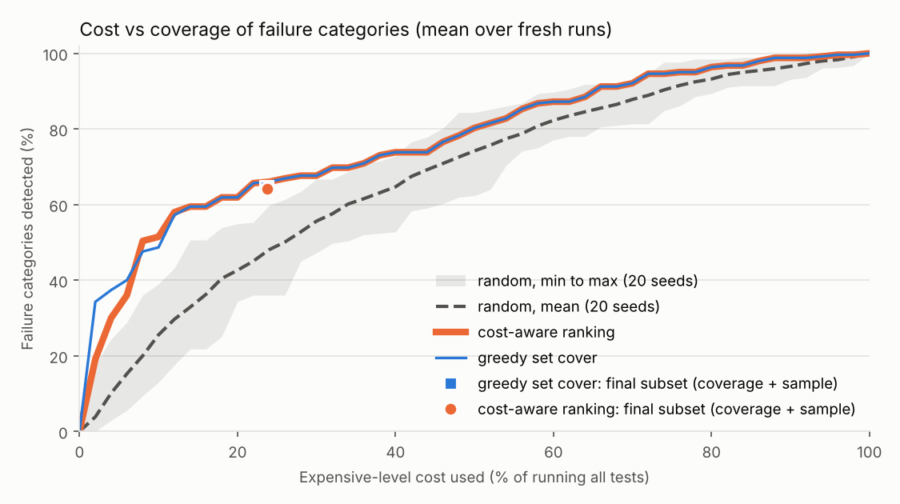

# Results

Generated by `python -m mfopt.run`. All numbers come from the synthetic test set in `data/testset.json` (150 tests) and the simulated assistant in this repo.

Note: High fidelity (LLM) skipped: disabled and not fully cached. Medium is used as the expensive level.

## Accuracy by fidelity level

| Level | Exact match | Intent accuracy | Slot F1 | Failed tests | Failure categories | Cost for 150 tests (s) |
|---|---|---|---|---|---|---|
| low | 46.7% | 49.3% | 0.581 | 80 | 30 | 0.1 |
| medium | 81.3% | 89.3% | 0.905 | 28 | 45 | 44.0 |

Cost is simulated seconds from the test set (`cost` field). High level would use about 68576 tokens for all tests.

## Failures by category and level (confusion-style view)

| Category | Tests | low failures | medium failures |
|---|---|---|---|
| climate | 42 | 28 (wrong_action 28) | 11 (wrong_action 4, wrong_slot_value 3, missing_slot 2, invalid_output 1, extra_slot 1) |
| media | 34 | 19 (wrong_action 18, missing_slot 1) | 6 (wrong_action 3, invalid_output 1, wrong_slot_value 1, missing_slot 1) |
| navigation | 18 | 9 (wrong_action 9) | 4 (wrong_action 2, invalid_output 2) |
| out_of_scope | 11 | 0 | 1 (wrong_action 1) |
| phone | 16 | 10 (wrong_action 9, missing_slot 1) | 3 (wrong_slot_value 2, missing_slot 1) |
| vehicle_info | 16 | 7 (wrong_action 6, missing_slot 1) | 3 (wrong_action 1, invalid_output 1, missing_slot 1) |
| windows | 13 | 7 (wrong_action 6, wrong_slot_value 1) | 0 |

## Failures by error type

| Error type | low | medium |
|---|---|---|
| invalid_output | 0 | 5 |
| wrong_action | 76 | 11 |
| missing_slot | 3 | 5 |
| wrong_slot_value | 1 | 6 |
| extra_slot | 0 | 1 |

## Accuracy by slice

| Slice | Tests | low exact match | medium exact match |
|---|---|---|---|
| difficulty=easy | 64 | 82.8% | 76.6% |
| difficulty=hard | 34 | 11.8% | 76.5% |
| difficulty=medium | 52 | 25.0% | 90.4% |
| language=de | 61 | 49.2% | 83.6% |
| language=en | 89 | 44.9% | 79.8% |
| noise=clean | 120 | 55.0% | 82.5% |
| noise=typo | 30 | 13.3% | 76.7% |

## Agreement between levels

| Pair (cheap vs expensive) | Pass/fail agreement | Cohen kappa | Identical output | Both pass | Cheap pass, expensive fail | Cheap fail, expensive pass | Both fail |
|---|---|---|---|---|---|---|---|
| low vs medium | 46.7% | -0.02 | 40.0% | 56 | 14 | 66 | 14 |

Failure categories (tag=value/error type) found at `medium` but not at `low`: category=climate/extra_slot, category=climate/invalid_output, category=climate/wrong_slot_value, category=media/invalid_output, category=media/wrong_slot_value, category=navigation/invalid_output, category=out_of_scope/wrong_action, category=phone/wrong_slot_value, category=vehicle_info/invalid_output, difficulty=easy/extra_slot, difficulty=easy/invalid_output, difficulty=hard/wrong_slot_value, difficulty=medium/invalid_output, difficulty=medium/wrong_slot_value, language=de/invalid_output, language=en/extra_slot, language=en/invalid_output, language=en/wrong_slot_value, noise=clean/invalid_output, noise=clean/wrong_slot_value, noise=typo/extra_slot.

Failure categories found at `low` but not at `medium`: category=navigation/missing_slot, category=phone/wrong_action, category=windows/missing_slot, category=windows/wrong_action, category=windows/wrong_slot_value, noise=typo/wrong_slot_value.

## Where the cheap level misses failures (14 tests pass at `low` but fail at `medium`)

| Test | Utterance | Category | medium error | medium output |
|---|---|---|---|---|
| t001 | stelle das Gebläse auf Stufe 5 | climate | wrong_action | `{"action": "unsupported", "slots": {}}` |
| t004 | book a flight and play it safe | out_of_scope | wrong_action | `{"action": "navigate", "slots": {}}` |
| t009 | set temperature to 17 | climate | wrong_slot_value | `{"action": "set_temperature", "slots": {"temperature": "16"}}` |
| t017 | bring mich bitte zu einem Restaurant | navigation | wrong_action | `{"action": "get_vehicle_status", "slots": {"destination": "restaurant"}}` |
| t035 | navigate to a restaurant nearby | navigation | invalid_output | `{"action": "navigate", "slots": {"destination": "restaurant` |
| t051 | change the volume level to 8 | media | invalid_output | `{"action": "set_volume", "slots": {"level": "8` |
| t053 | stelle die Temperatur auf 28 Grad | climate | missing_slot | `{"action": "set_temperature", "slots": {}}` |
| t061 | navigiere zu einem Parkhaus | navigation | invalid_output | `{"action": "navigate", "slots": {"destination": "parking` |
| t073 | spiele Popmusik | media | wrong_slot_value | `{"action": "play_media", "slots": {"genre": "rock"}}` |
| t077 | Lautstärke auf 3 | media | wrong_action | `{"action": "play_media", "slots": {"level": "3"}}` |
| t089 | set fan speed to 3 | climate | invalid_output | `{"action": "set_fan_speed", "slots": {"level": "3` |
| t092 | set temperature to 25 | climate | wrong_action | `{"action": "set_fan_speed", "slots": {"temperature": "25"}}` |
| t110 | what is my oil level | vehicle_info | invalid_output | `{"action": "get_vehicle_status", "slots": {"item": "oil_level` |
| t115 | stelle das Gebläse auf Stufe 1 | climate | wrong_action | `{"action": "unsupported", "slots": {}}` |

## Test selection

Cheap level: `low` (runs on all tests). Expensive level: `medium` (runs on the subset). Cost is `medium_s`. Each subset = the coverage tests chosen by the method plus a random sample of up to 10 cheap-pass and 10 cheap-fail tests, used to predict the expensive result of the tests that are not run. All rows show mean +- std over 20 seeds (the seed changes the prediction sample of a method, and the whole subset of a random baseline). Random baselines use the same subset size as the method above them.

Calibration run: 45 failure categories. Fresh runs (seeds 1 to 5): [55, 53, 46, 48, 45] failure categories.

| Method | Tests | Cost saved | Coverage (calibration run) | Coverage (fresh runs, mean) | Accuracy estimate error (pp) |
|---|---|---|---|---|---|
| greedy_set_cover (15 coverage + 20 sample) | 35 | 76.3% +- 0.3% | 100.0% +- 0.0% | 64.5% +- 3.2% | 5.7 +- 1.8 |
| random, same size | 35 | 76.4% +- 0.6% | 48.8% +- 12.5% | 47.7% +- 6.9% | 4.8 +- 1.7 |
| cost_aware_ranking (15 coverage + 20 sample) | 35 | 76.2% +- 0.5% | 100.0% +- 0.0% | 64.1% +- 3.7% | 6.4 +- 2.6 |
| random, same size | 35 | 76.4% +- 0.6% | 48.8% +- 12.5% | 47.7% +- 6.9% | 4.8 +- 1.7 |

Coverage = share of failure categories (tag=value/error type) of a run that the subset also detects. Accuracy estimate error = absolute difference between the estimated and the true expensive-level exact match on all tests, in percentage points, where the estimate uses cheap results on all tests and expensive results on the subset. For comparison, taking the cheap accuracy as the estimate would be off by 34.7 pp on the calibration run.

## Charts

